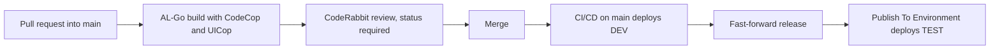

# The LA AI Guy — Business Central Extensions

Per-tenant extensions for Microsoft Dynamics 365 Business Central, built and shipped with [Microsoft AL-Go for GitHub](https://github.com/microsoft/AL-Go). The repo is a worked example of full push development: every change is a pull request that builds, is analysed and reviewed, merges, and deploys itself to DEV. A `release` branch then promotes the same commit to TEST.

Author: [The LA AI Guy](https://www.thelaaiguy.com) · GitHub [shiprek](https://github.com/shiprek). Shared for review; no license is granted.

## The apps

Each app has its own folder and `app.json`. AL-Go finds and builds every app folder on its own.

### `LeadExtension` — LAAI Leads (ids 50100–50149)

Lead tracking and website intake management. It adds:

- Lead tracking and lead-to-customer conversion
- A separate Website Intake entity for Squarespace submissions
- Review workflow for new and existing customers
- Controlled creation of open sales quotes and sales orders
- Website-origin and intake-reference fields on sales documents
- CSV import matching the 21-column `Website Intakes` Google Sheet export
- API pages for leads, website intakes and customer posting groups

### `TimeEntry` — LAAI Time Entry (ids 50150–50199)

A `LAAI Time Entry` table, list page and API page for recording time against a customer and project. A codeunit posts an open entry to the project through a job journal line, and another puts it on the resource's time sheet as a project line, then submits, approves and posts that line.

### `StandardAPI` — LAAI Standard API (ids 50200–50249)

Two read-only API pages over standard Business Central tables: `LAAI Job Ledger Entry API` (`jobLedgerEntries`) and `LAAI Time Sheet Line API` (`timeSheetLines`). The `LAAI Std API Read` permission set grants read access only.

## How a change ships

1. **Pull request.** Every change to `main` arrives as a pull request. The branch ruleset blocks direct pushes, force-pushes and deletion of `main`.
2. **Build and analysis.** The AL-Go **Pull Request Build** workflow compiles every app against a pinned Business Central artifact, with the CodeCop and UICop analyzers on. Its **Pull Request Status Check** must pass.
3. **Automated review.** CodeRabbit reviews every pull request. Its **CodeRabbit** status must pass, and every review thread must be resolved before merge.
4. **Merge.** Agent pull requests auto-merge once those required checks pass and the threads are resolved.
5. **DEV.** The **CI/CD** workflow runs on `main`, builds the apps and deploys them to the DEV sandbox on its own (continuous deployment).
6. **Promote.** After DEV is validated, `release` is fast-forwarded to that same commit on `main`.
7. **TEST.** **Publish To Environment** deploys from `release` to the TEST sandbox. TEST accepts deployments only from `release` and is never deployed automatically, so nothing reaches TEST without passing DEV first.

No production environment is configured yet.

The AL is drafted by an AI agent (pull requests titled "Agent draft: …", authored by `laai-agent[bot]`). It lands only through these reviewed, checked pull requests. The repo's rules ([AGENTS.md](AGENTS.md)) say agent-written AL is never edited by hand: a finding is fixed in the agent's next draft, not patched in place.

## Engineering practices

- **Analyzers in every build.** `enableCodeCop` and `enableUICop` in `.github/AL-Go-Settings.json`.
- **Pinned BC artifact.** `.AL-Go/settings.json` pins the sandbox version the build compiles against, so builds are repeatable and hit the artifact cache.
- **Extensible enums.** The `LeadExtension` enums and `LAAI Time Entry Status` are `Extensible = true`, so another app can add values. The review notes flag `LAAI Time Type` as still closed.
- **Versioned API pages.** Every API page has a publisher, group and `APIVersion` (`v1.0`), and is `Extensible = false`, so a breaking change means a new version.
- **Integration events.** `LAAI Website Intake Mgt`, `LAAI Post Time Entries` and `LAAI Time Sheet Entries` raise `OnBefore`/`OnAfter` events with `IsHandled`, so other apps can extend them.
- **Permission sets.** Each app ships its own permission sets, including read-only ones for API access.
- **App-only auth for data loads.** The **Import Leads** and **Apply BC Config** workflows request a GitHub OIDC token and exchange it for a Business Central token through federated credentials. No client secret is stored.
- **Written review.** [docs/code-review.md](docs/code-review.md) records a structure and standards review of the AL and what the next drafts should change.

## Operations

Build, deploy, and data-load steps are in [docs/operations.md](docs/operations.md).
